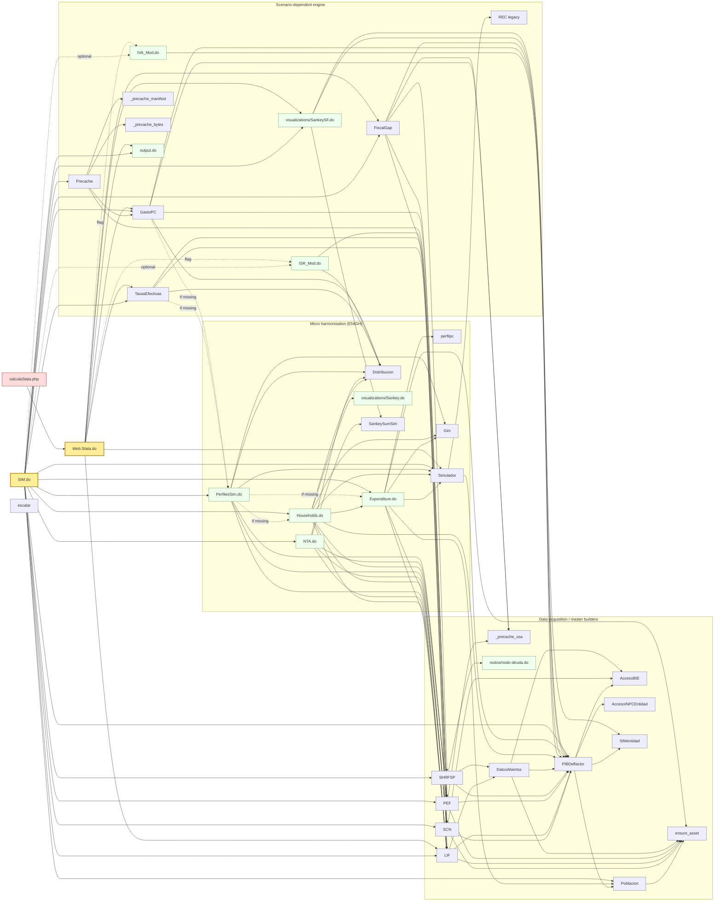

# Call graph — CIEP Fiscal Simulator (Stata), zip `SimuladorCIEP-master.zip` (v8.15.3, 2026-11-03)

Reconstructed from `do` / `run` / `include` statements and from calls to programs defined in the
shipped `.ado` files. Edge list with line numbers: `callgraph_edges.csv` (produced by
`scripts/callgraph.py`). Counts in brackets are the number of call sites in the caller.

## 1. Entry points

| Entry point | Who runs it | What it is |
|---|---|---|
| `SIM.do` | Ricardo, batch, ~32–35 min [observed: runbook §13 l.852, perf README] | Full pipeline: data → harmonisation → profiles → projection → Sankeys → `output.txt`. Canonical. |
| `01_modulos/Web.Stata.do` | `calculaStata.php` via `stata-mp -b do <id>.do` [observed: `calculaStata.php:114-144`] | Template with `{{placeholders}}`; runs only the scenario-dependent tail of the pipeline on pre-built artefacts, ~17–20 s [observed: perf README]. |
| `profile.do` | Stata at start-up in the researchers' folder | Sets `$SIMROOT`, `adopath`, `set type double`, defaults for `aniovp`/`anioPE` and the welcome screen. Not part of the computation. |
| `05_scripts/contrato-32.do`, `vintage-aportaciones.do`, `compuertas-entidad.do`, `pibe-32.do`, `test-nta-identidad.do` | shell scripts in `05_scripts/` | Secondary batch jobs (32 states, ENIGH vintages, gates). |

## 2. Execution order of `SIM.do` (batch)

```mermaid
flowchart TD
    SIM["SIM.do (§0 parameters: scalars, globals, matrices)"]
    SIM --> P1["§1 Poblacion (CONAPO pry23 asset → master/Poblacion.dta)"]
    P1 --> P2a["§2.4 PIBDeflactor ($pib/$def/$inf 2026-2032 → PIB, deflator, λ, WorkingAge)"]
    P2a --> P2b["§2.5 SCN (BIE frozen asset + CSI tabulados → master/SCN.dta, ~300 escalares)"]
    P2b --> P3a["§3.1 run Expenditure.do anioPE (ENIGH gasto → expenditures.dta, consumption_*_pc, categ_iva, IVA, IEPS)"]
    P3a --> P3b["§3.2 run Households.do anioPE (ENIGH ingreso → LISR, CSS, ISR, probits, Altimir, Yl/Yk → households.dta, cuadratura.do)"]
    P3b --> P3c["§3.2b run NTA.do anioenigh (NTA account per person → users/id/NTA/*.json)"]
    P3c --> P3d["§3.3 run PerfilesSim.do anioPE (re-anchor to LIF/PEF/SCN of anioPE; Simulador ×41 vars, bootstrap 250 → master/perfiles2027.dta, bootstraps/250/*REC*, *RECprom)"]
    P3d --> P4a["§4 LIF (revenue history) + revenue scalars + ISR/SE/DED/PM/CSS/IVAT/IEPST matrices"]
    P4a --> P4b["§4.7 TasasEfectivas, enigh (→ users/id/ingresos.dta: *_Sim)"]
    P4b --> P5a["§5 PEF (spending history) + spending scalars"]
    P5a --> P5b["§5.1b Precache (users/id/cache: PEF collapse, GastoPC base, REC_* collapses)"]
    P5b --> P5c["§5.2 GastoPC, cache (→ users/id/gastos.dta)"]
    P5c --> P6["§6 CGPE debt matrices → globals; SHRFSP (→ master/SHRFSP.dta, display, nodo-deuda)"]
    P6 --> P7["§7 use ingresos + merge gastos → AportacionesNetas; Simulador (B=1) → users/id/aportaciones.dta"]
    P7 --> P8a["§8.1 FiscalGap, end(anioPE+5) discount(8) (projection, debt iteration, output keys)"]
    P8a --> P8b["§8.2 run SankeySF.do ×5 cuts (+ entity variants)"]
    P8b --> OUT["output.do (if $output): writes the 47-key users/id/output.txt"]
```

## 3. Execution order of `Web.Stata.do` (one «Calcular» click)

```mermaid
flowchart TD
    PHP["calculaStata.php: validates idSession + numeric form fields, substitutes {{keys}} into Web.Stata.do, runs stata-mp -b"]
    PHP --> W0["§0 scalars aniovp/anioPE/anioenigh; $id={{idSession}}; $idbase=ricardo; $bootstrap=250; $algebra on"]
    W0 --> W2["§2 $pib2026..2032 = {{CRECPIB*}}, $def* = {{CRECDEF*}}; $inf* hard-coded"]
    W2 --> W31["§3.1 LIF → users/id/LIF.dta; 15 revenue scalars = {{INGRESOS*}}; matrices ISR/SE/DED/PM/CSS/IVAT from {{...}}; IEPST fixed"]
    W31 --> W316{"{{moduloCambio}}==1?"}
    W316 -- yes --> ISR["run ISR_Mod.do (recomputes ISRAS/ISRPF/ISRPM/CUOTAS on master/perfiles2027.dta → isr_mod.dta)"]
    W316 -- no --> W317
    ISR --> W317{"{{moduloCambioIva}}==1?"}
    W317 -- yes --> IVA["run IVA_Mod.do (master/2024/categ_iva.dta → iva_mod.dta)"]
    W317 -- no --> W318
    IVA --> W318["§3.1.8 TasasEfectivas, enigh (→ ingresos.dta)"]
    W318 --> W32["§3.2.1 34 spending scalars = {{...}}; GastoPC, cache (→ gastos.dta)"]
    W32 --> W33["§3.3 CGPE debt matrices (fixed) → globals; scalar tasaEfectiva = {{DEUDA0}}; SHRFSP NOT called here"]
    W33 --> W6["§6 use ingresos + merge gastos (+isr_mod/iva_mod) → AportacionesNetas; Simulador (B=1) → aportaciones.dta"]
    W6 --> W71["§7.1 FiscalGap, end(2032) discount(8) (calls SHRFSP internally)"]
    W71 --> W72["§7.2 run SankeySF.do ×5 → users/id/sankey-*.json"]
    W72 --> W73["§7.3 run master/2024/cuadratura.do (hex doubles from Households.do)"]
    W73 --> OUT["output.do → users/id/output.txt"]
    OUT --> PHP2["calculaStata.php parses NAME:[...] lines → JSON → stataCalcula.js renders"]
```

## 4. Program-level call graph (who calls what)

`escalar` (882 call sites in 18 files) and `Distribucion` (98 call sites in 7 files) are called from
almost every module and are omitted as edges for legibility. `scalarlatex` / `scalarjson` are
export-only side branches (`$textbook`, `$output`).

## 5. Programs shipped but not reached from `SIM.do` / `Web.Stata.do`

| Program | Status [observed] |
|---|---|
| `CuentasGeneracionales.ado` | Only call is commented out (`SIM.do:524`). Reads `users/$pais/$id/bootstraps/...` (`CuentasGeneracionales.ado:51,66`), a path layout no longer used. |
| `Perfiles.ado` (+ `PC.ado`, `PERF.ado`, `INCI.ado`, `CICLO.ado`, `REC.ado`) | v1.x per-replica machinery; superseded by the Mata engine in `Simulador.ado` (header l.5-37). `REC` is still reachable through `Simulador ..., legacy` (`Simulador.ado:317`). No other callers. |
| `Graphs_PC.do`, `Graphs_TE.do` | Commented out in `SIM.do:319,382`; used only to regenerate site images (runbook §1). |
| `SankeyCFE.do`, `SankeyPemex.do`, `TarjetaRFSP.do`, `nodos/portada.do`, `nodos/indicadores.do` | Side products (sister project `paquete-economico`); not in the fiscal pipeline. |
| `TasasEfectivasMicro.ado`, `TasasEfectivasEntidad.do`, `CicloEntidad.do`, `compuertas-entidad.do`, `contrato-32.do`, `pibe-32.do`, `sellar-pibe-32.do` | State-level (`$entidad`) branch; only when `$entidad` is set or via `contrato-32.sh`. |

## 6. Python and Mata embedded in the Stata code

| Where | Language | Purpose |
|---|---|---|
| `AccesoBIE.ado:298+`, `AccesoINPCEntidad.ado:58+` | Python (`requests`, `bs4`, `sfi`) | Download INEGI BIE series via API or public export page; write CSV for Stata. |
| `ensure_asset.ado:54+` | Python (`requests`, `hashlib`) | SHA-256 check of data assets against `05_scripts/manifest.json`; download from GitHub Release. |
| `SCN.ado:2991+` (`SCNCongelado`) | Python | Verify/copy the frozen SCN asset. |
| `sim_changelog.ado`, `profile.do:54-179` | Python | Welcome screen / changelog parsing. |
| `Simulador.ado:1303-1619` | Mata | Core profile/bootstrap/projection engine (`simboot_run`). |
| `perfilpc.ado:405+` | Mata | Intra-household expenditure allocation by fixed point. |
| `_precache_usa.ado`, `_precache_manifest.ado`, `_precache_bytes.ado` | Mata | Read tab-separated cache seal and manifest without macro expansion. |
| `CuentasGeneracionales.ado`, `REC.ado`, `PERF.ado`, `PC.ado` | Mata | Legacy matrix algebra. |
