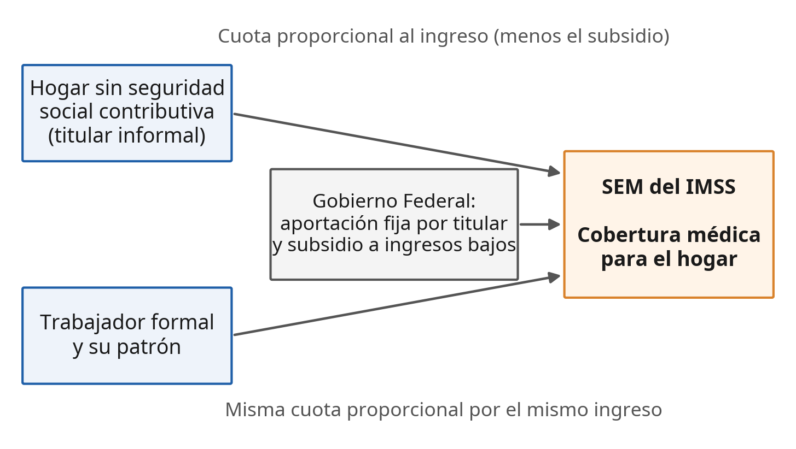
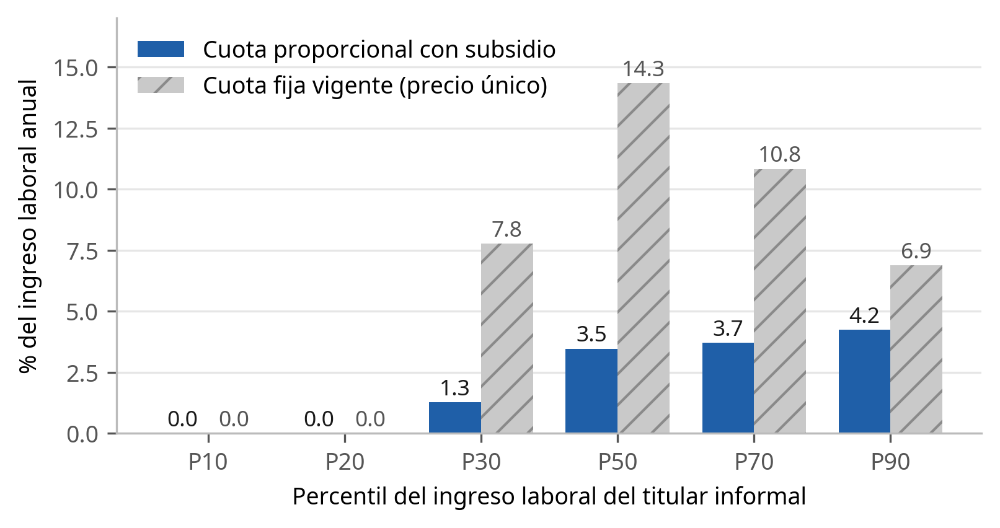
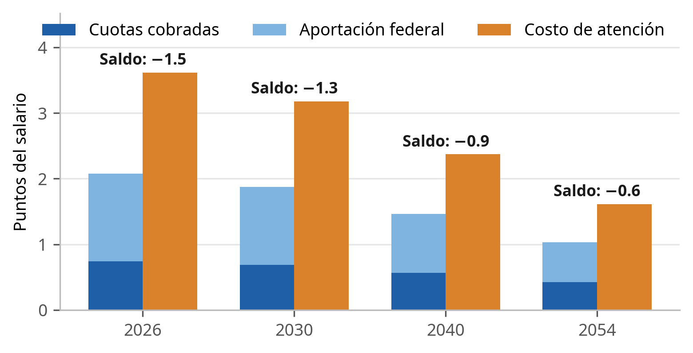
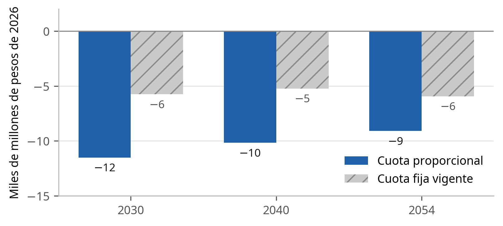
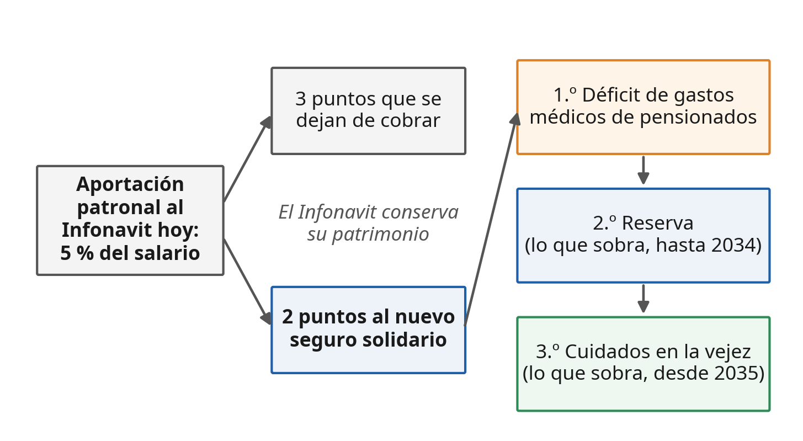
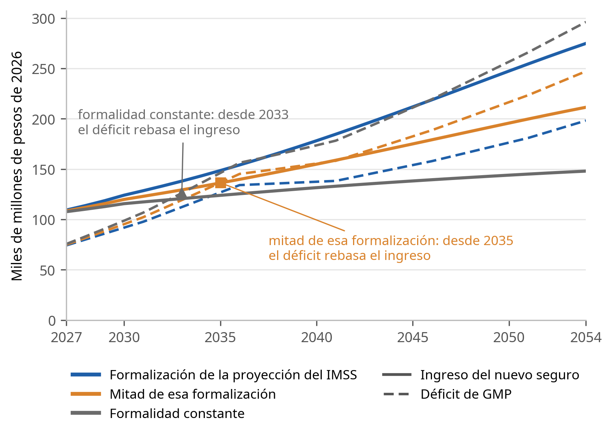
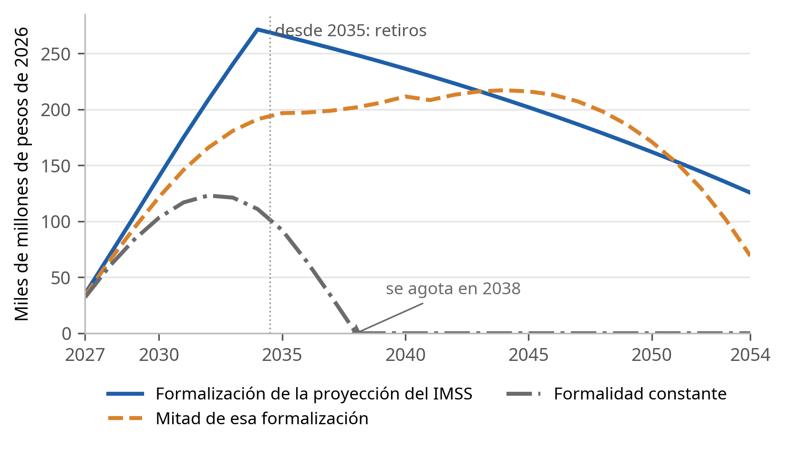
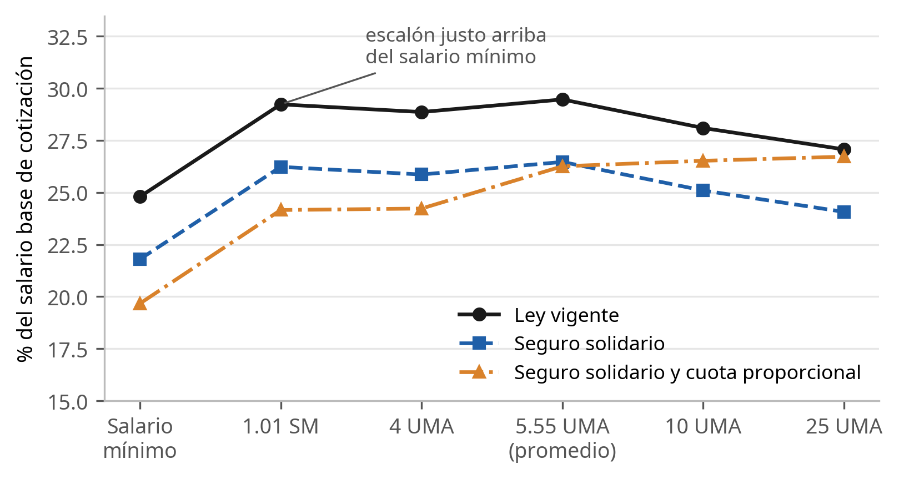

# 10. Esquemas de financiamiento alternativos

Este informe muestra que el gasto en salud del IMSS ya iguala a los ingresos del Seguro de Enfermedades y Maternidad (SEM). También advierte que el modelo no traslada a las cuotas los cambios en la formalidad (secciones 5.6 y 7). Esta sección explora dos formas de financiar mejor la atención. La 10a amplía la cobertura contributiva a quienes hoy no cotizan, con un pago que puedan sostener. La 10b financia el gasto médico de los pensionados y los cuidados en la vejez con una contribución que ya existe. Son ejercicios de ITED con insumos del IMSS: no son proyecciones del IMSS ni propuestas del IMSS o del Gobierno. Miden tasas legales, no quién paga en los hechos. Sus resultados no se suman.

## 10a. Afiliación subsidiada para hogares sin seguridad social

Este es un ejercicio de ITED con insumos del IMSS; no es una proyección del IMSS ni una propuesta del Instituto o del Gobierno. El detalle técnico está en el Anexo X.

## 10a.1 El problema

Muchos hogares trabajan, pero no tienen seguridad social. Según la ENIGH 2024, 59.2 millones de personas viven en 19.7 millones de hogares con al menos un ocupado sin cobertura contributiva y no tienen esa cobertura.

La cuota del SEM no ayuda a cerrar esa brecha. Hoy el patrón paga una cuota fija por trabajador igual a 20.40 % de la UMA por día. La UMA (Unidad de Medida y Actualización) es el valor de referencia en pesos que sustituyó al salario mínimo en las leyes. Como la cuota es fija, pesa más en los salarios bajos: para un trabajador de salario mínimo equivale a 7.6 % de su salario en 2026. Además, sigue a la inflación y no al salario, por lo que pierde peso con el tiempo (véase la sección 3.2).

## 10a.2 La idea

El esquema cambia la cuota fija por una cuota proporcional al salario. La cuota proporcional se calcula para recaudar en 2026 lo mismo que la cuota fija: 3.467 % del salario. El salario base de cotización (SBC) es el salario sobre el que se calculan las cuotas al IMSS.

Funciona en cuatro pasos (Figura 10.1):

- Los hogares sin seguridad social pueden afiliarse al SEM y pagan la misma cuota proporcional sobre el ingreso de quien más gana en el hogar.
- Los hogares de ingresos bajos y medios bajos reciben un subsidio que baja conforme sube el ingreso. Cubre todo el pago de 20 % de los hogares con menos ingreso y se reduce hasta desaparecer en la mitad de la distribución.
- El Gobierno Federal aporta por cada titular una cantidad fija, igual a 14.83 % de la UMA por día, como hoy lo hace por cada trabajador formal.
- Un trabajador formal con el mismo ingreso paga lo mismo. Nadie paga distinto por el mismo ingreso según sea formal o informal.

{width="6in"}

**Figura 10.1. Cómo funciona la afiliación subsidiada.**

*Fuente: elaboración de ITED.*

**Ejemplo ilustrativo.** Pensemos en un hogar cuyo principal perceptor trabaja sin seguridad social y gana el ingreso mediano de ese grupo, 2.46 UMA al día en 2026. Con la cuota proporcional pagaría 3,647 pesos al año: 3.5 % de su ingreso laboral y 1.7 % del ingreso del hogar. Con la cuota fija vigente pagaría 15,087 pesos, 14.3 % de su ingreso laboral. Un hogar con menos ingreso, en el percentil 30, pagaría 1.3 % de su ingreso laboral porque recibe subsidio. A cambio, el hogar recibe la atención médica del SEM para el titular y sus familiares.

## 10a.3 Supuestos

Los supuestos son ilustrativos, no estimaciones. La Tabla 10.1 los resume. El Anexo X muestra cómo cambian los resultados con otros valores.

**Tabla 10.1. Supuestos principales de la afiliación subsidiada.**

| Supuesto | Valor | Por qué ese valor | Qué pasa si cambia |
|---|---|---|---|
| Proporción de hogares que se afilia | 50 % | Una afiliación casi total no es creíble sin descuento automático | Más afiliación, más cobertura y mayor saldo negativo (sección 10a.5) |
| Proporción de las cuotas que efectivamente se cobra | 75 % | Parte de las cuotas de los no asalariados no se cobra | Menos cobro empeora el saldo |
| Sobrecosto de atención de quienes se afilian primero | 10 % | Quienes más necesitan atención se afilian antes | Más sobrecosto, más costo |
| Días cotizados al año | 337 | Supuesto del Informe del IMSS (Cuadro II.18) | Cambia la masa salarial de referencia |
| Umbrales del subsidio | Crecen con el ingreso real | Así el subsidio no se retira sin una decisión explícita | Con umbrales fijos, el subsidio se reduce con el tiempo |
| Costo de atención por edad | Las personas de 65 años o más cuestan el triple que las de 20 a 64 | Perfil estilizado sobre el costo promedio del SEM | Un perfil más plano o más empinado mueve poco el saldo |

*Fuente: elaboración de ITED con base en el Informe del IMSS 2025-2026 y la ENIGH 2024.*

## 10a.4 Resultados

**Con los supuestos base, el esquema cubriría a unos 31.4 millones de personas en 2030 con un pago de 3.5 % del ingreso laboral en el hogar mediano. El costo de atención supera lo que aportan los hogares y el Gobierno Federal: queda un saldo sin fuente de financiamiento asignada de unos 81 mil millones de pesos al año, 1.3 puntos del salario en 2030.** [REVISAR-Beth]

**Cobertura.** Los 31.4 millones de personas equivalen a 39.7 % de los 79.2 millones de derechohabientes que reporta el Informe del IMSS (véase la nota al final de esta subsección). No quedarían cubiertos otros 8.2 millones de personas sin seguridad social que viven en hogares sin ocupados informales; 19.5 % de ellas tiene 65 años o más.

**Asequibilidad.** Con la cuota proporcional, el pago va de 0 % del ingreso laboral en los hogares de menor ingreso a 4.2 % en el percentil 90 (Figura 10.2). Con la cuota fija vigente llegaría a 14.3 % en la mediana. Como contexto, en el quinto decil un hogar pagaría 4,097 pesos al año y hoy gasta de su bolsillo en salud 5,773 pesos.

{width="6in"}

**Figura 10.2. Pago anual del hogar como porcentaje del ingreso laboral del titular, 2026.**

*Fuente: elaboración de ITED con base en la ENIGH 2024. La cuota fija vigente es un precio único por titular. Cómo leerla: cada par de barras compara lo que pagaría un hogar del mismo ingreso con cada cuota.*

**Saldo para el SEM.** En 2030 los hogares afiliados deberían pagar unos 57 mil millones de pesos y se cobrarían unos 43 mil millones. El Gobierno Federal aportaría unos 74 mil millones: 68 de aportación fija y 6 de subsidio. El costo de atención sería de unos 197 mil millones. El saldo sin fuente asignada sería de unos 81 mil millones, 12.9 % de los ingresos del SEM. [REVISAR-JP: ingresos del SEM del Informe del IMSS (Cuadro V.13), 2.5 % más altos que los de la Tabla 5 en 2030] En pesos, el saldo casi no cambia hacia 2054 (unos 80 mil millones). En puntos del salario baja de 1.3 a 0.6, porque la proyección del IMSS supone que la masa salarial crece mucho (Figura 10.3).

{width="6in"}

**Figura 10.3. Ingresos y costo de la afiliación subsidiada (puntos del salario).**

*Fuente: elaboración de ITED con base en el Informe del IMSS 2025-2026, el libro de la Dirección de Finanzas y la ENIGH 2024. Los puntos del salario se miden sobre la masa salarial con tope de 25 UMA y 337 días cotizados.*

**Más formalidad frente a lo que hay hoy.** La sección 7 señala que el modelo no traslada a las cuotas el efecto de la formalidad. Para medirlo, el Anexo X supone que 3 millones de personas más cotizan en 2030. Es un supuesto ilustrativo, no una estimación. Cada nuevo cotizante gana cerca del salario mínimo y trae 2.9 derechohabientes. Su atención cuesta más de lo que aporta su cuota. El efecto neto para el SEM en 2030 sería de unos −6 mil millones de pesos con la cuota fija vigente y de unos −12 mil millones con la cuota proporcional (Figura 10.4). La aportación fija del Gobierno Federal por estos cotizantes sería de unos 18 mil millones.

{width="6in"}

**Figura 10.4. Efecto neto para el SEM de 3 millones de cotizantes más en 2030.**

*Fuente: elaboración de ITED. Solo considera la atención médica del SEM, no los demás seguros.*

**Efecto de la cuota proporcional sobre los formales.** Este efecto va aparte y no forma parte del saldo del esquema. En 2026 la cuota proporcional recauda de los formales lo mismo que la cuota fija. Después crece con el salario real y la cuota fija no: la diferencia sería de unos 12 mil millones de pesos en 2030 y de unos 99 mil millones en 2054, 0.7 puntos del salario.

Como contexto, el gasto federal en salud para la población sin seguridad social fue de unos 326 mil millones de pesos de 2026 en el presupuesto de 2026.

## 10a.5 Qué tan robusto es

Tres supuestos mueven la lectura:

- **Proporción que se afilia.** Con 70 % el saldo de 2030 sería de 1.8 puntos del salario; con 30 %, de 0.8 puntos.
- **Cobro.** Si solo se cobra la mitad de las cuotas, el saldo de 2030 sube a 1.5 puntos.
- **Costo por persona.** Si crece 2 % real al año, el saldo de 2054 llega a 1.8 puntos.

Si la afiliación fuera individual y cada persona pagara sobre el ingreso por persona del hogar, el saldo de 2030 bajaría a 0.2 puntos.

## 10a.6 Lo que el ejercicio no dice

- No mide quién soporta en los hechos la cuota ni el efecto sobre la decisión de formalizarse.
- No incluye inversión en hospitales ni la capacidad para atender a más personas.
- El ingreso de la ENIGH no es el salario base de cotización.
- La afiliación, el cobro y el sobrecosto son supuestos, no estimaciones.

## 10a.7 En resumen

- Una cuota proporcional al salario permitiría afiliar a hogares sin seguridad social con un pago de 3.5 % del ingreso laboral en la mediana.
- El esquema cubriría a unos 31.4 millones de personas en 2030.
- Deja un saldo sin fuente asignada de unos 81 mil millones de pesos al año: 1.3 puntos del salario en 2030 y 0.6 en 2054.
- Con 3 millones de cotizantes más, el efecto neto para el SEM es negativo: unos −6 mil millones de pesos en 2030 con la cuota vigente.

**Nota sobre derechohabientes.** Este informe usa 70.7 millones de derechohabientes en 2025, estimados con CONAPO y la ENIGH 2024 (sección 4.2). El mismo cálculo con la variable de afiliación de la ENIGH da 54.6 millones. El Informe del IMSS reporta 79.2 millones. La diferencia está en conciliación y no cambia los resultados de esta sección. [REVISAR-JP: conciliación de derechohabientes]

## 10b. Del Infonavit a un seguro de salud y cuidados en la vejez

Este es un ejercicio de ITED con insumos del IMSS; no es una proyección del IMSS ni una propuesta del Instituto o del Gobierno. El detalle técnico está en el Anexo X, segunda parte.

## 10b.1 El problema

El SEM tiene dos partes. La de gastos médicos de pensionados (GMP) atiende a las personas pensionadas y a sus familiares. Es el hueco de financiamiento más grande del SEM. Su déficit equivale a unos 2,631 mil millones de pesos en valor presente a 30 años (Informe del IMSS, Cuadro V.24). El valor presente suma los montos de varios años como si se pagaran hoy, con una tasa de 3 % real.

Al mismo tiempo, el patrón aporta 5 % del salario al Infonavit, el fondo de vivienda de los trabajadores. Esta subsección pregunta si parte de esa aportación puede cubrir el déficit de GMP y, al mismo tiempo, bajar la cuña contributiva legal. La cuña contributiva legal es la suma de las contribuciones que la ley pone a cargo del patrón y del trabajador sobre la nómina.

## 10b.2 La idea

El ejercicio cambia el destino de la aportación al Infonavit (Figura 10.5):

- Se elimina la aportación de 5 % del salario al Infonavit, con el mismo tope de 25 UMA.
- 2 % del salario financia un seguro nuevo, solidario: un fondo común, no una cuenta individual.
- Los otros 3 puntos se dejan de cobrar. La tasa legal sobre la nómina baja 3 puntos en todo salario hasta 25 UMA.
- El seguro paga primero el déficit de GMP. Hasta 2034 guarda lo que sobra en una reserva. Desde 2035 destina a cuidados en la vejez lo que sobra, más un monto fijo de la reserva en los años sin faltante.
- El Infonavit conserva lo que ya tiene.

{width="6in"}

**Figura 10.5. Del 5 % actual al nuevo seguro.**

*Fuente: elaboración de ITED.*

**Ejemplo ilustrativo.** Un trabajador con el salario promedio ganaba 627.87 pesos al día en diciembre de 2025, 5.55 UMA. Hoy, de cada 100 pesos de su salario, su patrón aporta 5 al Infonavit. Con el nuevo seguro aportaría 2 al seguro solidario y dejaría de aportar los otros 3. Las contribuciones que la ley pone a cargo del patrón pasarían de 25.1 % a 22.1 % del salario en 2026. Los 2 pesos se suman a los de todos los cotizantes. Primero pagan el gasto médico de los pensionados y luego, cuidados en la vejez.

## 10b.3 Supuestos

**Tabla 10.2. Supuestos principales del seguro solidario.**

| Supuesto | Valor | Por qué ese valor | Qué pasa si cambia |
|---|---|---|---|
| Inicio y periodo | 2027 a 2054 | Mismo horizonte que la proyección del IMSS, sin su último año | — |
| Déficit de GMP | El del Informe del IMSS (Cuadro V.24), con provisiones (montos que el IMSS separa para gastos de operación) | Es la cifra institucional | Sin provisiones, la cobertura dura más (sección 10b.5) |
| Formalización | Tres escenarios con el mismo peso: la que supone la proyección del IMSS, la mitad de ella y formalidad constante | Acotan lo que pasa si la formalización es distinta de la que supone la proyección | Con menos formalización entra menos dinero y crece el déficit |
| Rendimiento de la reserva | 3 % real | Tasa de descuento del Informe del IMSS | — |
| Retiro para cuidados | Desde 2035, un monto fijo de la reserva en los años sin faltante | GMP va primero | — |
| Gasto de GMP con menos formalización | Igual al del Informe | Los pensionados del periodo ya están definidos por su historia laboral | Solo cambia el ingreso de GMP |

*Fuente: elaboración de ITED con base en el Informe del IMSS 2025-2026.*

## 10b.4 Resultados

**Con una reserva que se acumula hasta 2034, el 2 % alcanza para pagar el déficit de gastos médicos de pensionados en todo el periodo 2027-2054, tanto con la formalización que supone la proyección del IMSS como con la mitad de ella. Si la formalidad se queda como está hoy, alcanza hasta 2037.**

**Ingreso frente a déficit.** En 2027 el seguro recibiría unos 109 mil millones de pesos, frente a un déficit de GMP de unos 74 mil millones. En 2054 serían unos 275 y 198 mil millones con la formalización de la proyección del IMSS. Con menos formalización, el ingreso crece menos y el déficit más, porque GMP también cobra menos (Figura 10.6).

{width="6in"}

**Figura 10.6. Ingreso del nuevo seguro y déficit de GMP, 2027-2054.**

*Fuente: elaboración de ITED con base en el Informe del IMSS 2025-2026 (Cuadro V.24) y el libro de la Dirección de Finanzas. Cómo leerla: donde la línea punteada pasa por encima de la continua del mismo color, el ingreso del año no alcanza para el déficit.*

**El papel de la reserva.** La reserva no crea recursos: cambia cuándo y para qué se usan. En cada escenario, lo que se destina a cuidados más lo que queda en la reserva, menos lo que falta para GMP, vale lo mismo con reserva y sin ella. Con la formalización de la proyección del IMSS, la reserva llega a unos 271 mil millones de pesos al inicio de 2035 y no se agota. Con la mitad de esa formalización, la reserva paga los faltantes de GMP hasta 2054, pero casi no deja recursos para cuidados. Con formalidad constante, se agota en 2038 (Figura 10.7).

{width="6in"}

**Figura 10.7. Saldo de la reserva del nuevo seguro, 2027-2054.**

*Fuente: elaboración de ITED. Saldo al cierre de cada año.*

**Lo que queda para cuidados.** Con la formalización de la proyección del IMSS, el seguro destinaría a cuidados unos 5,631 pesos al año por persona de 65 años o más con IMSS en 2040 y unos 6,696 en 2054. Por persona de 80 años o más serían 26,318 y 23,771 pesos. Antes de 2035 no hay gasto en cuidados. Es un recurso disponible, no un costo de cuidados. Las personas de 65 años o más con IMSS se calculan con CONAPO y la ENIGH 2024, el mismo método de la sección 4.2.

**La cuña legal por nivel de salario.** En 2026 las contribuciones a cargo del patrón por ley pesan más en el salario mínimo (26.5 %) que en el salario promedio (25.1 %) y que en 25 UMA (22.7 %). En 2030 ya no es así: por el calendario de aumento de la cuota de cesantía y vejez, el mínimo queda en 24.8 % y el promedio en 29.5 % (Figura 10.8). El seguro solidario baja 3 puntos en todos los niveles. Si además se aplica la cuota proporcional de la sección 10a, la cuña baja 7.1 puntos en el salario mínimo, 3.2 en el promedio y 0.3 en 25 UMA en 2026. Esta es la única combinación de las dos subsecciones que se presenta. Ninguno de los dos ejercicios modifica el escalón justo arriba del salario mínimo: en 2030 es de 4.4 puntos con la ley vigente y de 4.5 con ambos cambios.

{width="6in"}

**Figura 10.8. Contribuciones a cargo del patrón por ley según el nivel de salario, 2030.**

*Fuente: elaboración de ITED con base en la Ley del Seguro Social y el calendario de la reforma de 2020. Se mide en % del salario base de cotización; el escalón se calcula con los tramos expresados en UMA. Cómo leerla: cada línea es un régimen de contribuciones.*

En el agregado, la tasa legal más baja equivale a unos 164 mil millones de pesos en 2027. Como contexto, la aportación de 5 % al Infonavit equivale a unos 273 mil millones ese año.

## 10b.5 Qué tan robusto es

**Tabla 10.3. Último año en que el seguro paga completo el déficit de GMP.**

| Escenario | Con reserva | Con reserva, sin provisiones | Sin reserva | Sin reserva, sin provisiones |
|---|---|---|---|---|
| Formalización de la proyección del IMSS | 2054 | 2054 | 2054 | 2054 |
| Mitad de esa formalización | 2054 | 2054 | 2034 | 2041 |
| Ritmo histórico | 2049 | 2050 | 2034 | 2039 |
| Formalidad constante | 2037 | 2042 | 2032 | 2034 |

*Fuente: elaboración de ITED. 2054 significa todo el periodo.*

- **Ritmo histórico.** Entre 2005 y 2025 la formalidad subió 6.5 puntos; la proyección supone 29.1 puntos en 29 años. Si la formalización siguiera el ritmo histórico, la formalidad llegaría a 43.5 % en 2054. Con reserva, el seguro alcanzaría hasta 2049.
- **Provisiones.** Se concentran en algunos años, como 2036. Sin ellas, la cobertura dura más, sobre todo en la mitad de la formalización sin reserva: hasta 2041 en lugar de 2034 (Tabla 10.3).
- **Masa salarial.** El libro de la Dirección de Finanzas y el Informe suponen trayectorias distintas de la masa salarial. Con la del Informe, la formalización de la proyección del IMSS sigue cubriendo todo el periodo, con un margen mínimo de unos 7 mil millones de pesos en 2036.

## 10b.6 Lo que el ejercicio no dice

- No mide quién soporta en los hechos la cuña ni cuánto valoran los trabajadores el seguro frente a su ahorro para vivienda.
- No cuantifica los efectos en las pensiones ni en otros seguros, que dependen de los saldos de vivienda.
- No modela la operación ni la liquidez del Infonavit.
- No evalúa la factibilidad política.

## 10b.7 En resumen

- Con reserva, 2 % del salario paga el déficit de GMP hasta 2054 con la formalización de la proyección del IMSS y con la mitad de ella; con formalidad constante, hasta 2037.
- La reserva no crea recursos: en la base, cuidados más reserva valen unos 802 mil millones de pesos en valor presente, con reserva y sin ella.
- Con la formalización de la proyección del IMSS quedan para cuidados unos 5,631 pesos al año por persona de 65 años o más en 2040.
- La tasa legal sobre la nómina baja 3 puntos hasta 25 UMA; el escalón arriba del salario mínimo no cambia.
